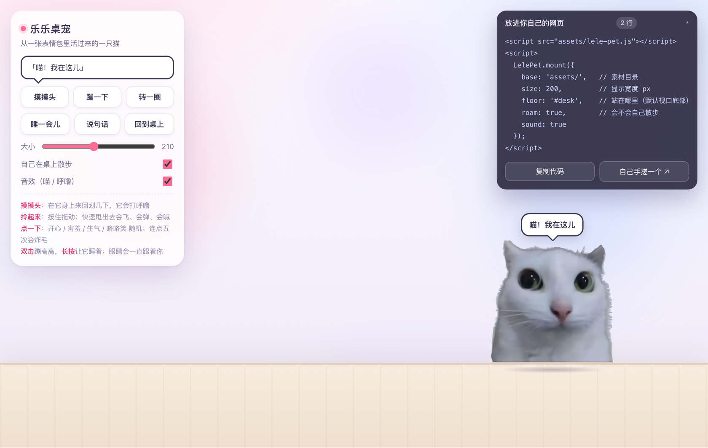
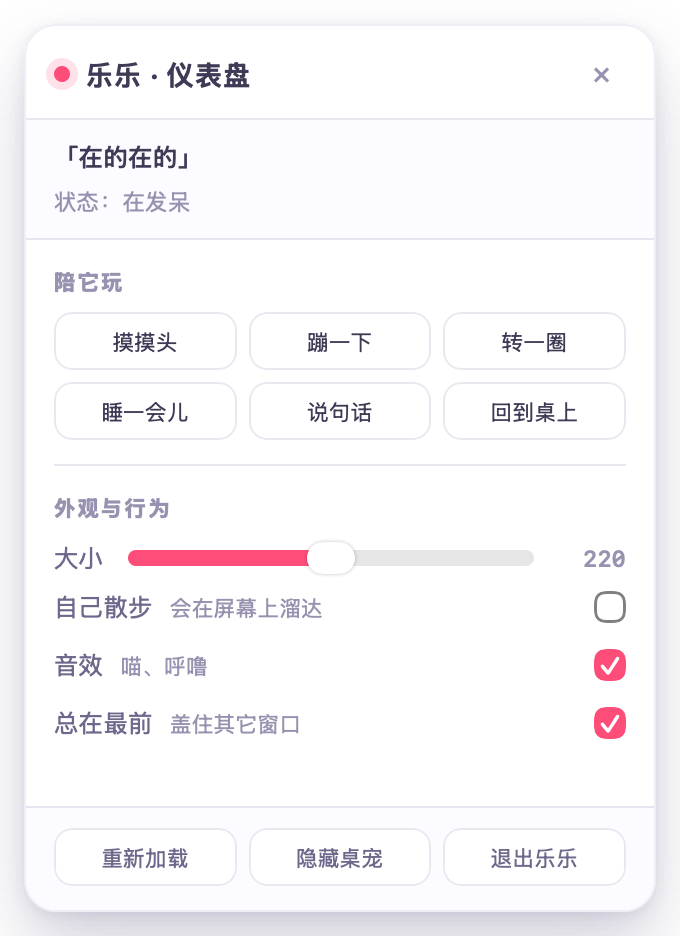

# 乐乐桌宠 · Lele Cutepet

把一张**静态表情包**变成一只**会动、能摸、能拖、能甩飞**的网页桌宠。

> 原图就是那张左上角带「乐乐」气泡的白猫表情包。项目把它抠了出来，去掉气泡，
> 并且**只靠这一张图**做出了眨眼、视线跟随、呼吸、挤压回弹、腮红、表情等动画 ——
> 没有用任何逐帧素材，也没有用任何第三方库。



**它不止是个网页**：`desktop/` 里有真正贴在桌面上的小窗 —— 透明、总在最前、
点它不抢焦点、眼睛跟着真实光标、右键弹出仪表盘（摸头/蹦/转圈/睡觉/说话/回到桌上/大小/散步/音效/置顶）。
macOS 用原生壳（1MB，`desktop/macos/`），Linux / Windows 用 Electron 壳（`desktop/electron/`）。
详见 [desktop/README.md](desktop/README.md)。



> **想自己从零搓一只？** 打开 **[site/index.html](site/index.html)** ——
> 文档站形式的教程，**每一步都给你完整代码**：整段复制 → 覆盖上一版 → 双击打开，
> 一版一版看着它活过来。
>
> V1 呼吸（191 行）→ V2 眨眼（234）→ V3 视线（271）→ V4 回应你（455）→ V5 拖拽甩飞（629）
>
> 五个版本都在 [build/](build/)，每个都是能单独运行的文件；纯文字版在 [TUTORIAL.md](TUTORIAL.md)。

参考形态：[人工智能导论实操手册](file:///Users/zhangyuxiang/Desktop/worksplace/AIIntroduceCourse/index.html) 右下角那只角落桌宠（那只基于 dsh-pet 的 VP9 透明视频）。
本项目的思路不同：**不预渲染视频**，而是把眼睛从原图里拆出来做成可动部件，实时用 Canvas 合成。

---

## 〇、本地跑起来（推荐）

```bash
./serve.sh            # 默认 8000，被占用会自动往后找
```

然后打开：

| 地址 | 是什么 |
| --- | --- |
| http://localhost:8000/site/ | **教程站**（从这里开始读） |
| http://localhost:8000/ | 成品：乐乐桌宠 |
| http://localhost:8000/build/05-物理.html | 从零手搓的最终版源码 |

想放到桌面上（macOS）：

```bash
cd desktop/macos && ./build.sh && open build/乐乐桌宠.app     # macOS
cd desktop/electron && npm install && npm start               # Linux / Windows
```

> 也可以完全不用服务器：直接双击 `index.html` 也能玩。
> 起服务的好处是 `http://localhost` 属于安全上下文，`navigator.clipboard` 可用，复制代码更顺。

---

## 一、马上看效果

双击 `index.html`（`file://` 直接打开就行，不需要服务器、不需要联网、不需要装任何东西）。

页面打开后：

| 操作 | 反应 |
| --- | --- |
| 鼠标在它身上**来回划** | 打呼噜、脸红、冒爱心 |
| **按住拖动** | 被拎起来，身体拉长、随速度摆动，眼睛往上看 |
| **快速甩出去** | 抛物线飞出去、撞墙弹、落地弹跳 + 压扁回弹 + 灰尘 |
| **点一下** | 随机：开心 / 咯咯笑 / 惊讶 / 害羞 / 生气，各配不同台词 |
| **连点 5 次** | 炸毛 💢 |
| **双击** | 蹦高高 |
| **长按 / 75 秒不理它** | 睡着，冒 Zzz；再摸一下或点一下就醒 |
| 鼠标在页面里移动 | 眼睛一直跟着你（4 秒不动就自己东张西望） |
| 没人理它 | 自己碎碎念、偶尔在桌上散步（可在控制台关掉） |

左上角控制台可以调大小、开关散步和音效；右上角是嵌入代码。

---

## 二、放进你自己的网页（2 行）

```html
<script src="assets/lele-pet.js"></script>
<script>
  LelePet.mount({
    base: 'assets/',   // 素材目录（默认自动取脚本同目录）
    size: 200,         // 显示宽度 px
    floor: '#desk',    // 站在哪条线上；不传=视口底部
    roam: true,        // 自己散步
    sound: true
  });
</script>
```

`lele-pet.js` 是**单文件、零依赖、经典脚本**（不是 ESM），样式也由它自己注入，
所以只要有 `lele-pet.js` + `assets/` 里那 4 张图，扔进任何页面都能跑。

## 三、配置项

| 选项 | 默认 | 说明 |
| --- | --- | --- |
| `base` | 脚本同目录 | 素材目录（`lele-skin.png` 等所在处） |
| `size` | `210` | 显示宽度（px），之后可用 `setSize()` 改 |
| `x` | `0.78` | 初始位置：`0~1` 当视口比例，`>1` 当像素中心；小屏默认居中 |
| `fixed` | `true` | `true` 固定视口；`false` 随文档滚动（用绝对定位） |
| `floor` | 视口底部 | 地面线：数字（视口 y）/ 函数 `(pet)=>y` / CSS 选择器 / DOM 元素 |
| `roam` | `true` | 会不会自己在桌上散步 |
| `sound` | `true` | 音效（WebAudio 现场合成，无音频文件） |
| `volume` | `0.3` | 音量，`0` 等于静音 |
| `dock` | `false` | 悬停时显示「摸摸 / 跳跳 / 睡吧 / 隐藏」小工具条 |
| `greet` | `true` | 出现时打个招呼 |
| `hidden` | `false` | 是否默认隐藏（隐藏状态记在 `localStorage`） |
| `posKey` | `'lele-pet-pos'` | 位置记忆的键；传 `null` 不记 |
| `hideKey` | `'lele-pet-hidden'` | 隐藏记忆的键 |
| `lines` | — | 覆盖台词，如 `{ poke: ['喵！'], pat: ['再来'] }` |
| `zIndex` | `2147483000` | 层级 |
| `onSay / onPoke / onReady / onAction` | — | 回调 |

## 四、API

```js
const pet = LelePet.mount({ /* 上面的配置 */ });

pet.say('写完了记得提交');     // 说一句（会冒气泡）
pet.pat(true);                // 摸一下（force=true 忽略冷却）
pet.poke();                   // 点一下（随机表情）
pet.hop();                    // 蹦一下
pet.spin();                   // 转个圈 / 蹦高高
pet.sleep();  pet.wake();     // 睡 / 醒
pet.walkTo(600);              // 走到某个 x（中心像素）
pet.setSize(260);             // 改大小
pet.setVolume(0);             // 静音
pet.hide(); pet.show();       // 藏起来 / 叫回来
pet.pause(); pet.resume();    // 暂停渲染（省电）
pet.destroy();                // 彻底移除
```

台词表在 `LelePet.LINES`（可以整体替换或按 key 覆盖）：
`hello poke happy shy angry giggle pat drag fly land sleep wake idle`。

---

## 五、原理：一张静态图怎么「活」起来

难点在于原图里眼睛和脸是同一张位图，眨不了眼、转不了眼珠。做法是**把眼睛拆成独立图层**：

```
lele-skin.png   底层「皮」：和 lele.png 一样，但两只眼睛被扩散算法抹平成毛
lele-eye-l.png  左眼贴片：椭圆羽化透明边，包含眼睛本身 + 一圈毛
lele-eye-r.png  右眼贴片
```

于是：

- **眨眼** = 把眼睛贴片朝眼睛中心纵向压扁 → 剩下的空隙由底层的毛补上，看起来就是眼皮合上；
- **视线跟随** = 把眼睛贴片朝鼠标方向平移几像素 → 空出来的一侧露出底层（像眼白/眼窝），
  眼睛就像真的转过去了；
- **呼吸 / 蹦跳 / 压扁 / 摔落** = 以「脚底中心」为锚点做 `scale + rotate`，挤压时脚不离地；
- **腮红** = 在猫身上叠粉色径向渐变，用 `globalCompositeOperation:'source-atop'` 保证只落在猫身上；
- **表情** = 上面这些参数（眼睛开合、倾斜、挤压、腮红、上下浮动）按时间组合成一段段关键帧。

抠图和拆眼睛由 `tools/build-sprites.py` 完成（Pillow + numpy）：

1. 背景是均匀冷灰，按颜色距离取「前景」，再腐蚀 6px 断掉气泡尾巴与左耳的细连接，
   从鼻头灌水取连通域，膨胀回去取交集 → 干净地只剩下猫；
2. 边缘按「离背景色的距离」做软过渡，毛边不会是硬锯齿；
3. 两只眼睛用椭圆遮罩标记成洞，用 Jacobi 扩散（只用洞外像素）把洞填成毛 → 「皮」；
4. 眼睛贴片 = 原图对应区域 + 椭圆羽化 alpha。

```bash
./serve.sh                          # 本地起服务（http://localhost:8000）
python3 tools/build-sprites.py      # 重新生成 assets/ 里的素材（参数已钉死，结果可复现）
python3 tools/build-docs.py         # 改完 build/ 后，把源码重新灌进教程页

# 换成别的图就用通用脚本：
python3 tools/split-sprite.py --src 你的图.jpg --out pet --grid          # 先出网格量眼睛
python3 tools/split-sprite.py --src 你的图.jpg --out pet \
    --seed 540,700 --eye-l 424,581,74,68 --eye-r 781,595,64,62 --preview
```

> 换了素材（比如换一只猫）就改脚本里的 `EYES` 几何，再同步 `lele-pet.js` 顶部的
> `SPRITE` / `EYES` / `CHEEKS` 常量（`assets/lele-sprite.json` 里是同一份数据）。

---

## 六、文件

```
index.html                  演示页 + 控制台 + 嵌入代码
assets/
  lele-pet.js               桌宠组件（单文件、零依赖）★
  lele-skin.png             底层「皮」（眼睛被抹平）
  lele-eye-l.png            左眼贴片
  lele-eye-r.png            右眼贴片
  lele.png                  抠好的整猫（可当图标 / 不支持 canvas 时兜底）
  lele-fallback.jpg         原图（素材全挂了时的静态兜底立绘）
  lele-original.jpg         原始表情包（资料，不参与运行）
  lele-sprite.json          精灵与眼睛几何（由构建脚本生成）
desktop/macos/              桌面版 · macOS 原生壳（Swift + AppKit，1MB，零依赖）
desktop/electron/           桌面版 · Linux / Windows / macOS（Electron）
  README.md                 透明窗口 / 不抢焦点 / 点穿 / 拖拽怎么做的
  macos/
    Pet.swift               外壳：透明浮窗 + 仪表盘 + 菜单栏 + 拖拽 + 视线推送 + 散步
    pet.html                桌面用的透明页面（dragMode: 'external'）
    dashboard.html          右键弹出的控制面板（复用网页那套 UI）
    dashboard.png           仪表盘截图（文档用）
    Info.plist  build.sh    打包成 .app（只用系统自带 swiftc）
    build/乐乐桌宠.app       产物：双击即用，1MB
site/                       ★ 文档站形式的教程（从这里开始读，每版都贴了完整代码）
  index.html                0 · 这只桌宠长什么样（带可玩的演示）
  step-1-cut.html           1 · 抠图：把猫拿出来
  step-2-eye.html           2 · 拆眼睛：眨眼的前提（可拆开看三层素材）
  step-3-draw.html          3 · 画出来：呼吸与挤压
  step-4-eye.html           4 · 眨眼 + 盯着你（含镜像坑现场复现）
  step-5-touch.html         5 · 能摸、能拖、能甩飞
  customize.html            6 · 换成你的图 · 拖滑块调参（实时预览 + 生成代码）
  ship.html                 7 · 上线前检查
  basics-html.html          A · 附录：HTML / CSS 速成（零基础）
  basics-js.html            B · 附录：JavaScript 速成
  basics-canvas.html        C · 附录：Canvas 速成（含可拖动的变换演示）
  basics-debug.html         D · 附录：调试与报错对照
  desktop.html              8 · 变成桌面桌宠（透明窗口 / 点穿 / 端到端测试）
  demo.html                 首页/调参页嵌的演示（支持 ?size=&roam=&sound=）
  assets/docs.css docs.js   教程站的样式与脚本（目录/页内目录/代码复制/角落桌宠）
TUTORIAL.md                 同一份教程的纯文字版
build/                      ★ 从零手搓的 5 个完整文件（每版独立可运行，直接复制）
  01-呼吸.html               V1 · 191 行：画布留白 / 脚底锚点 / 呼吸 / 挤压
  02-眨眼.html               V2 · 234 行：三层素材 / 眨眼
  03-视线.html               V3 · 271 行：视线跟随（含镜像 bug 现场复现）
  04-互动.html               V4 · 455 行：表情 / 气泡 / 粒子 / 抚摸 / 腮红
  05-物理.html               V5 · 629 行：拖拽 / 甩飞 / 弹跳 / 落地挤压
tools/
  split-sprite.py           通用拆图脚本（任意图 → 桌宠素材，支持 --crop/--mask）
  build-docs.py             把 build/ 的源码灌进教程页的代码块里（保证两边永远一致）
  build-sprites.py          本项目一键构建（钉死乐乐的参数，可复现）
  pose-gallery.html         16 种姿态一览（开发用，肉眼校验动画）
  smoke-test.html           交互冒烟测试（合成事件跑一遍，输出结果）
```

## 七、兼容性与注意事项

- **浏览器**：Chrome / Edge / Safari / Firefox 现代版本都行；用了 `Promise`、`canvas`、
  `Pointer Events`、`WebAudio`，没有用 ES module，所以 `file://` 直接打开也能跑。
- **移动端**：触屏可用（点、拖、抚摸都是 Pointer Events），小屏默认居中出现；
  控制台在窄屏会变成底部卡片。手指按住桌宠时不会带动页面滚动。
- **省电**：切到后台标签页会暂停渲染；`prefers-reduced-motion` 会自动关掉散步。
- **无障碍**：桌宠可 Tab 聚焦，回车/空格等于点它一下；气泡是 `aria-live`。
- **音效**：浏览器要求先有一次用户交互，所以第一次点击/拖动之后才会出声。
- **版权**：`assets/lele-pet.js`、页面、构建脚本是本项目自己的代码；
  原始表情包版权归原作者，这里只做演示用途。
